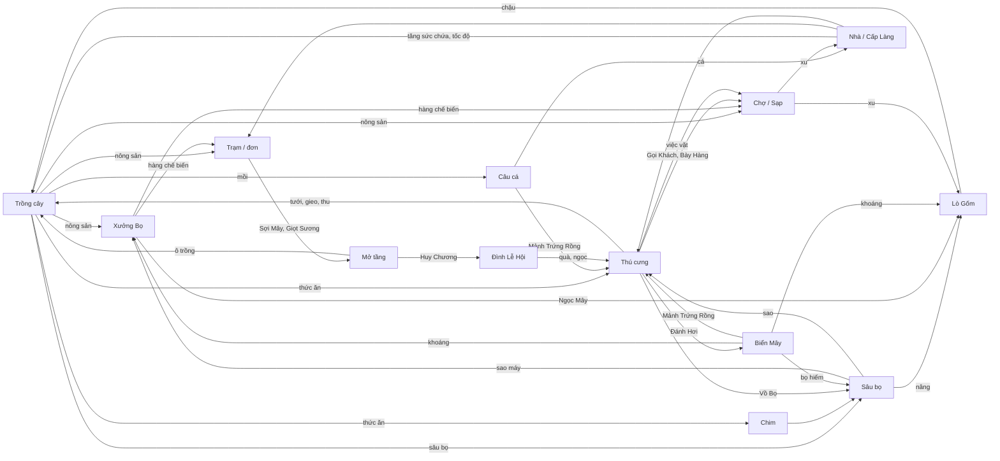

# MẠNG LIÊN KẾT CÁC HỆ — Phú Bà Trồng Cây (chỉ thị 11 TỔNG § F)

Mỗi hệ có ít nhất 2 đầu vào và 2 đầu ra (CTO đã kiểm). Cột "Ở đâu trong mã" chỉ chỗ luật nằm, để kiểm khi đổi số.
Mọi vòng tạo xu khép kín đã qua mô phỏng: `docs/reviews/economy-11.md` (`npx tsx tools/economy-11.ts`).

## Bảng

| Hệ thống | Đầu vào (nhận từ) | Đầu ra (đưa cho) | Ở đâu trong mã |
|---|---|---|---|
| Trồng cây | Hạt (Lò, Sẻ Nhặt Hạt, việc vặt Tìm hạt), chậu (Lò), tưới (Rồng Mưa Ngọc, Cáo Lửa Ấm), gieo lại (Sẻ) | Nông sản → Xưởng, Chợ, đơn, thức ăn chim và thú cưng, mồi câu; sâu bọ | `core/game.ts` (plant, water, harvest), `systems/growth.ts` |
| Sâu bọ | Cây, chim, Cáo Vồ Bọ, việc vặt Săn bọ, Biển Mây | Nâng chậu, nâng sao máy, Tháp Chim, Xưởng, sao thú cưng | `game.ts` catchBug (dùng chung cho chim, Cáo, BOT) |
| Chim (Tháp Chim) | Hạt Kê, nông sản, xu, ngọc | Sâu bọ; chim dẫn đường cho đơn | `systems/birds.ts`, `botBirds.ts` |
| Xưởng Bọ | Nông sản, khoáng, bọ để nâng sao | Hàng chế biến → đơn, Chợ, nâng nhà, thức ăn thú cưng; Ngọc Mây → đúc chậu, Rồng | `systems/workshop.ts` |
| Trạm / đơn | Nông sản, hàng chế biến, chim dẫn đường, hàng xóm góp | Xu, EXP, Sợi Mây, Giọt Sương, bọ hiếm | `systems/orders.ts` |
| Chợ Mây / Sạp | Nông sản, hàng chế biến, Mèo (Gọi Khách, Tự Bày Hàng, Khách Quý, Thương Đoàn) | Xu; mua Sợi Mây, Giọt Sương, khoáng, mồi từ BOT | `systems/neighbors.ts`, `bazaar.ts` |
| Biển Mây (Cổng) | Năng Lượng Gió, Cáo Đánh Hơi đánh dấu rương, nâng Cổng | Khoáng → Lò và Xưởng; Sợi Mây, Giọt Sương; Mảnh Trứng Rồng; bọ hiếm | `systems/sea.ts`, `ui/seaPanel.ts` |
| Câu cá (Bến) | Mồi chế từ nông sản và Hũ Mứt | Cá → nâng Cổng; Giọt Sương; Mảnh Trứng Rồng; Sổ Cá | `systems/fishing.ts` |
| Lò Gốm (chậu, đúc) | Xu, bọ, khoáng, Ngọc Mây | Chậu tốt hơn; bộ chậu; sao chậu | `systems/pots.ts`, `casting.ts`, `potStars.ts` |
| Mở tầng | Xu, Sợi Mây, Giọt Sương, cấp | Ô trồng; vùng trời mới và Huy Chương Độ Cao; đặc tính tầng | `systems/floors.ts`, `core/floorgen.ts`, `village.ts` awardMedals |
| Thú cưng | Món thích, Huy Hiệu, bọ, xu/ngọc | Bán hàng, bắt bọ, gieo/thu, tưới; việc vặt ra mọi tài nguyên; kết hợp | `systems/pets.ts`, `game.ts` runPets / runHarvestHelp / replantAfter |
| Nhà và Cấp Làng | Nguyên liệu của mọi hệ (D2) | Tăng sức chứa và tốc độ của mọi hệ | `systems/village.ts` houseBonus, villagePerk |
| Đình Lễ Hội | Mọi hoạt động (nhiệm vụ), điểm danh | Quà, điểm sự kiện, ngọc, Huy Hiệu | `systems/quests.ts`, `missions.ts`, `village.ts` claimCheckIn |
| BOT hàng xóm | Luật chung của người chơi | Mua ở Sạp, bán ở Chợ, nhận giúp vườn | `neighbors.ts`, `botBirds.ts`, `botVillage.ts` |

## Sơ đồ

## Vòng tạo xu khép kín (đã kiểm)

| Vòng | Vì sao không vô hạn |
|---|---|
| Mèo Tự Bày Hàng ↔ Sẻ Gieo Lại ↔ Thu Hoạch Hộ | Bày Hàng chỉ bán hàng có trong kho; Gieo Lại trả tiền hạt; Thu Hoạch Hộ chỉ thu cây đã chín; cả ba có giới hạn mỗi ngày hoặc theo thời gian lớn. Gieo Lại mặc định tắt. |
| Việc vặt ↔ Chợ | 4 việc/ngày (+ Nhà Thú Cưng), mỗi bé một việc; xu theo cấp người chơi (~0,6% thu nhập 30 ngày). |
| Câu cá ↔ chế mồi | Mồi đắt hơn giá cá (CTO chỉnh), giới hạn lần câu mỗi ngày. |
| Đào → Mài Ngọc → bán | Năng Lượng Gió hồi theo giờ, có trần. |
| Nâng nhà ↔ giảm giá | Giảm giá nhỏ hơn tiền nâng nhà. |
