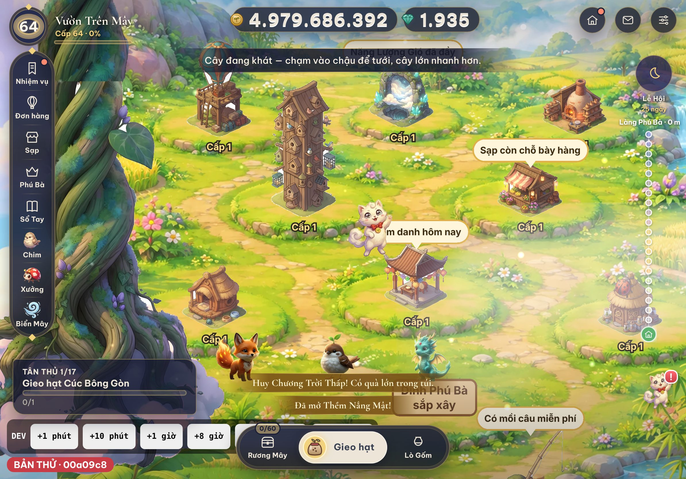
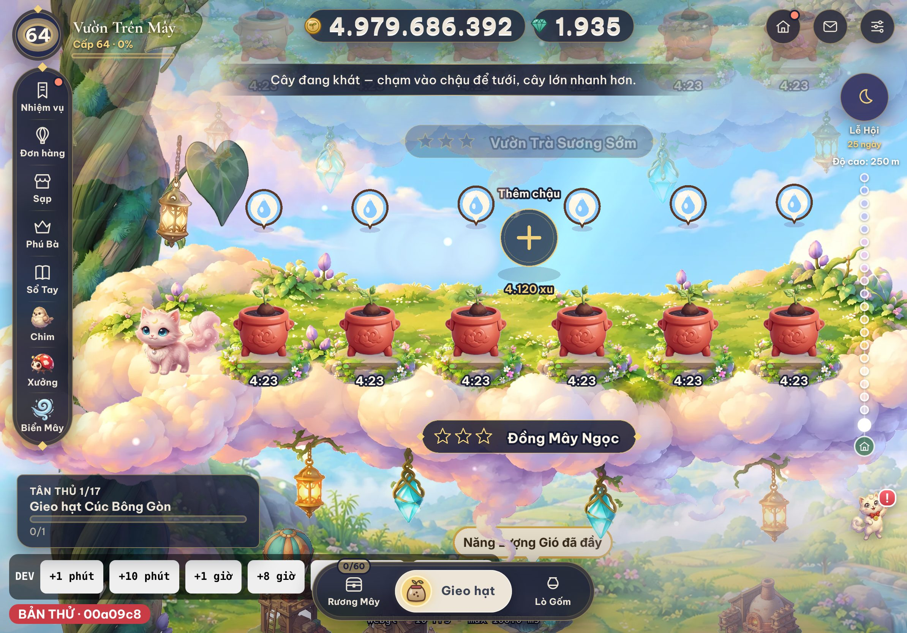
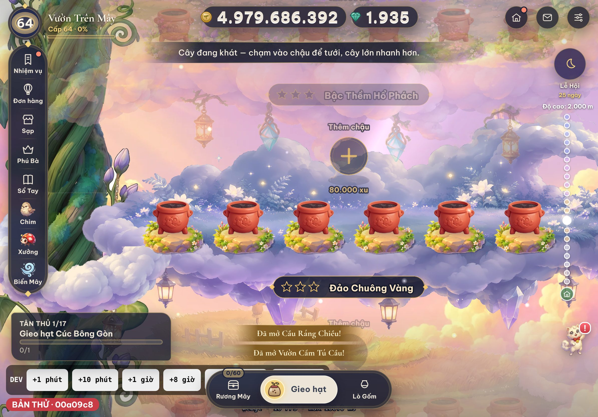
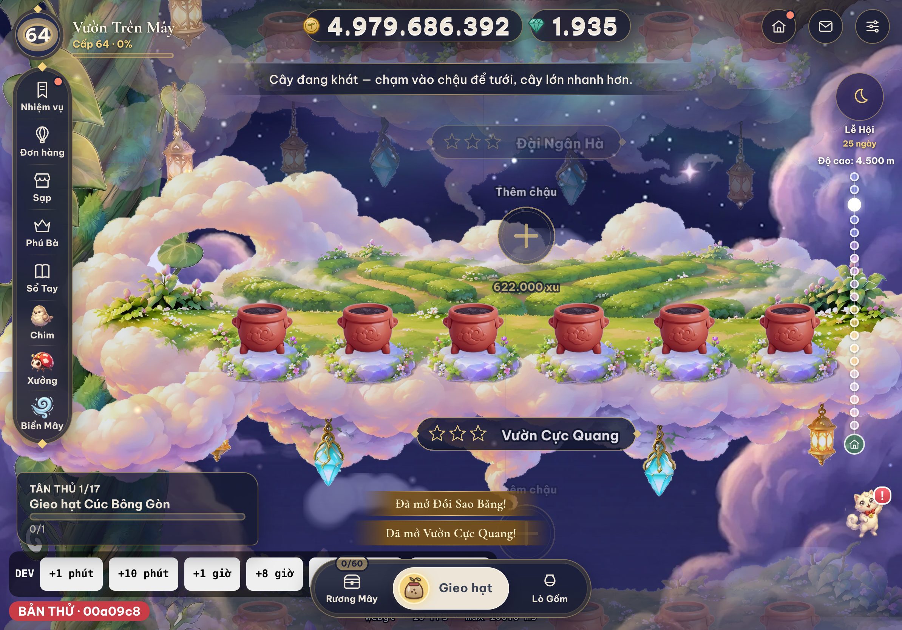
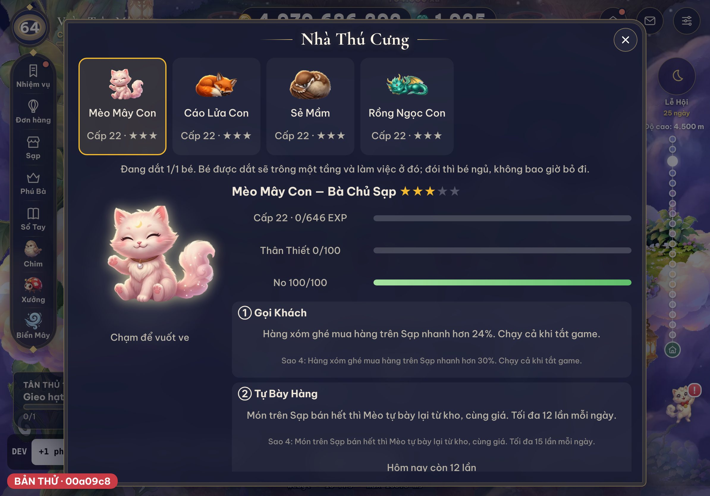
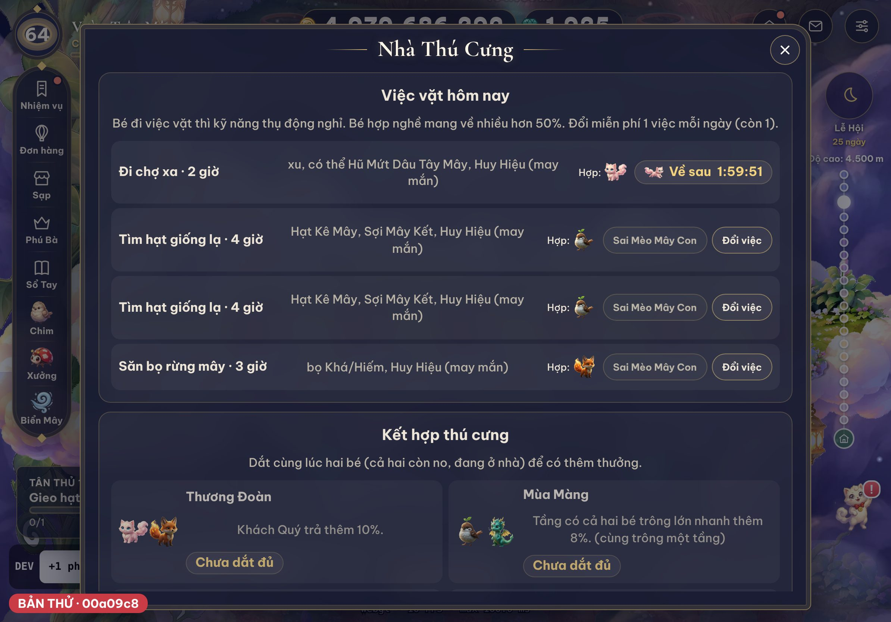

# Báo cáo chỉ thị 11 TỔNG — Làng Phú Bà, thú cưng, 20 tầng (2026-11-18)

**Bản thử:** https://dungcu10.github.io/phu-ba-trong-cay/ (tự cập nhật từ nhánh `feat/11-tong`).
**Kiểm tra:** `npm run check` XANH; save đời 13 (migration 12→13), save cũ mở được.
**Tag (đẩy từ máy chủ dự án):** m-11-n4a, m-11-n5a, m-11-n5b, m-11-n5c, m-11-n6, m-11-n2a, m-11-n3a, m-11-n2b, m-11-n3b, m-11-n7, m-11-n8.

## Đã làm theo bước

| Bước | Nội dung | PR |
|---|---|---|
| N1 | Xử lý ảnh: 5 tấm trời, 8 nhà, 3 thú cưng (`tools/art/build_village.py`) | #22 |
| N2 | Trời thị sai 4 vùng, 20 tầng theo vùng (lật hình, màu phủ, bệ đá), 16 tên tầng, thước đo độ cao, tên vùng khi vào lần đầu, vuốt dừng đúng tầng; đàn chim / tia nắng / sao / cực quang; cây leo mọc khi mở tầng | #27, #29 |
| N3 | Làng dưới tầng 1: 8 nhà trên ô đất, biển Dinh Phú Bà, Bến Câu Cá; bong bóng báo; chạm nhà mở chức năng; Xu Xu đi dạo, hàng xóm ghé Chợ, chuyển động nhà, màn mở nhà | #28, #30 |
| N4 | Nâng nhà, Cấp Làng, Huy Chương Độ Cao, điểm danh | #22 |
| N5 | 4 thú cưng, 12 kỹ năng, cấp, sao, Thân Thiết, hành vi (chạy tới chỗ làm, không che chậu chín) | #23, #24, #25 |
| N6 | Việc vặt, kết hợp thú cưng, túi quà của Sẻ, nhiệm vụ thú cưng và hành trình cấp cao | #24, #26, #29 |
| N7 | BOT có làng và thú cưng (dùng chung luật), migration 13 | #22, #31 |
| N8 | Kiểm tổng, hiệu năng, `FEATURE_WEB.md`, `economy-11.md`, báo cáo này | #32 |

## Ảnh chụp (2388×1668)

1.  Làng Phú Bà: nhà, bong bóng báo, Xu Xu, thú cưng ở nhà, Bến Câu Cá.
2.  Tầng 1 với Mèo trông tầng, thước đo độ cao, làng phía dưới.
3.  Vùng Trời Vàng / Hoàng Hôn: bệ sa thạch, màu phủ, tầng 9 Bậc Thềm Hổ Phách.
4.  Thiên Giới Đêm: sao, cực quang, bệ đá trăng.
5.  Bảng thú cưng: 4 bé, kỹ năng ở sao hiện tại và sao kế tiếp, giới hạn mỗi ngày.
6.  Việc vặt (bé hợp nghề, đồng hồ về) và kết hợp thú cưng.

## Kinh tế (chi tiết: `docs/reviews/economy-11.md`, mạng liên kết: `docs/FEATURE_WEB.md`)

- Đạt: 4 thú cưng ngày 15; vắng 24 giờ thu nhập 2% (≤ 35%); thưởng % trên một lần thu hoạch +17% / +23% (≤ 60%); chim + Cáo tăng bọ +27% (≤ 45%); việc vặt 0,6% thu nhập; không vòng xu vô hạn.
- **Cho CTO:** Cấp Làng 10 ở ngày 3 (mục tiêu ~7), Cấp Làng 25 ở ngày 16 (mục tiêu ~30), mở tầng 5 ở ngày 13 (mục tiêu 20–25). Đây là số giá/thời gian nâng nhà và nhịp cấp — để CTO chỉnh qua mô phỏng.
- Hiệu năng: 40 BOT × 7 ngày (đủ chim, làng, thú cưng) ~130 ms trên máy dev, test đặt ngưỡng 250 ms theo § I (máy chạy song song nhiều test đôi khi đo > 200 ms).

## Quyết định tự chọn chính (đã ghi trong CHANGELOG)

- Gieo Lại Như Cũ mặc định tắt; Lửa Ấm = tưới rút ngắn thêm (phần ban đêm CTO đã quyết không làm); Đánh Hơi phần vườn hàng xóm làm cùng B5 chỉ thị 12.
- Mùa Màng tính lúc gieo/bắt đầu vụ; Ban Lộc dùng tầng Rồng trông.
- BOT: Sẻ và Rồng (giá ngọc) nở ở cấp mở + 3; vật liệu nhà BOT mua theo giá thị trường; tiền nâng nhà lấy từ phần "đầu tư" sẵn có.
- Thưởng các nhiệm vụ/hành trình mới chỉ có xu (thưởng ngọc / Đất Sét làm lệch chỉ số chậu chữ ký và Bọ Rất hiếm).

## 16 tên tầng 5–20 (chờ CTO duyệt)

5 Đồi Gió Nhẹ · 6 Thềm Nắng Mật · 7 Vườn Hướng Dương Mây · 8 Đảo Chuông Vàng · 9 Bậc Thềm Hổ Phách · 10 Sân Mây Kim Tuyến · 11 Thung Lũng Oải Hương · 12 Hồ Tím Hoàng Hôn · 13 Rặng Mây Hồng Đào · 14 Cầu Ráng Chiều · 15 Vườn Cẩm Tú Cầu · 16 Bến Đom Đóm · 17 Đồi Sao Băng · 18 Vườn Cực Quang · 19 Đài Ngân Hà · 20 Đỉnh Thiên Giới.

## CẦN HÌNH

- Quả khinh khí cầu tách riêng khỏi hình Trạm (để bay lên khi gửi đơn, hạ xuống khi về).
- Đuôi Cáo Lửa Con còn viền hồng nhạt sau khi tách nền.

## Chưa làm / để sau

- Video cuộn từ làng lên tầng 20 (máy chủ không quay được; xem bản thử).
- Chỉ tải nền trời của vùng đang xem và 2 vùng kề: hiện tải cả 4 tấm (~60 MB ảnh, vẫn dưới 350 MB).
- Phần còn lại chỉ thị 12: B3 Phú Bà động + giải tuần, B4 trộm, B5 giúp vườn, phần C giao diện.
