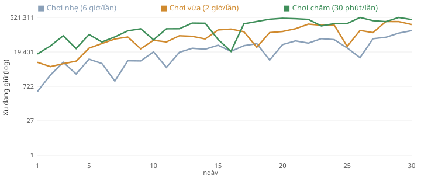
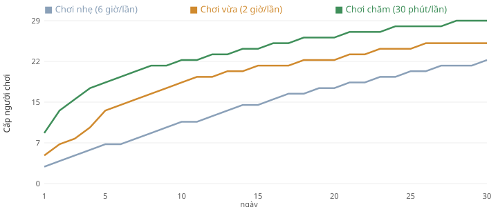
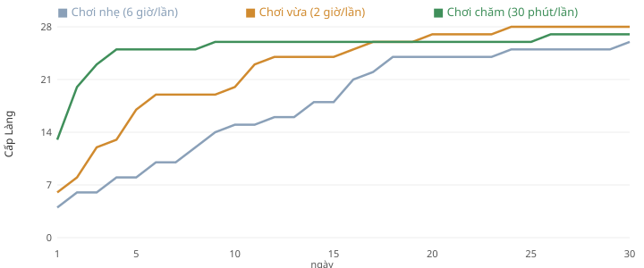

# Kinh tế chỉ thị 11 TỔNG — làng, thú cưng (30 ngày, 3 kiểu người chơi)

> Tạo bằng `npx tsx tools/economy-11.ts` từ bộ mô phỏng của CTO (`tools/progression.ts`), 2026-11-18.
> Bot mô phỏng: xây nhà, điểm danh, nuôi thú cưng, việc vặt, chim, xưởng, đúc chậu, Biển Mây, câu cá (theo luật CTO viết).

## Kết quả theo ràng buộc phần H

| # | Ràng buộc | Đo được (người chơi vừa) | Kết quả |
|---|---|---|---|
| 1a | Đủ 4 thú cưng khoảng ngày 12–16 | ngày 15 | đạt |
| 1b | Cấp Làng 10 khoảng ngày 7 | ngày 4 | ngoài khoảng |
| 1c | Cấp Làng 25 khoảng ngày 30 | ngày 26 (ngày 30: Cấp Làng 25) | đạt |
| 1d | Mở tầng 5 khoảng ngày 20–25 | ngày 21 | đạt |
| 2 | Vắng 24 giờ (chỉ thú cưng, chim, xưởng chạy): thu nhập ≤ 35% người chơi vừa | 2.531 xu (gồm giá bán đồ nhận được) / 281.905 xu một ngày chơi = 1% | đạt |
| 3 | Tổng thưởng phần trăm trên một lần thu hoạch ≤ 60% | lớn nhất trên vườn ngày 30: sản lượng +14%, tốc độ +21% | đạt |
| 4 | Có Cáo và chim: tổng bọ tăng ≤ 45% | 544 / 2.234 con do chim + thú cưng bắt → +32% so với không có | đạt |
| 5 | Không có vòng tạo xu vô hạn | xem mục dưới; việc vặt mang về 66.764 xu = 1.1% thu nhập 30 ngày | đạt |

## Vòng tạo xu (mục H.5)

- **Mèo Tự Bày Hàng ↔ Sẻ Gieo Lại ↔ Thu Hoạch Hộ:** Bày Hàng chỉ bày lại hàng có trong kho, giá người chơi đặt (trong khoảng giá cho phép), tối đa 5→15 lần/ngày; Gieo Lại trả tiền hạt như người chơi (tối đa 20→60 chậu/ngày); Thu Hoạch Hộ chỉ thu cây đã chín, theo thời gian lớn. Không vòng nào sinh xu nếu không có cây lớn thật.
- **Việc vặt ↔ Chợ:** số việc mỗi ngày cố định (4 + Nhà Thú Cưng), mỗi bé một việc một lúc; xu theo cấp người chơi.
- **Câu cá ↔ chế mồi:** CTO đã chặn (mồi 6 Bạc Hà Mây, xu cá ÷3, số lần câu mỗi ngày).
- **Đào → Mài Ngọc → bán:** Năng Lượng Gió hồi theo giờ, có trần; xưởng chạy theo hàng đợi.
- **Nâng nhà ↔ giảm giá:** giảm giá chậu của Lò không vượt tiền nâng Lò (mỗi cấp chỉ giảm vài phần trăm, tiền nâng tăng theo U).

## Biểu đồ

## Bảng theo ngày

### Chơi nhẹ (6 giờ/lần)

| Ngày | Cấp | Xu | Thu nhập ngày | Cấp Làng | Thú cưng | Tầng | Bọ do chim + thú cưng | Việc vặt |
|---|---|---|---|---|---|---|---|---|
| 1 | 3 | 439 | 631 | 4 | 0 | 1 | 0 | 0 |
| 3 | 5 | 10.736 | 12.208 | 6 | 1 | 1 | 0 | 0 |
| 5 | 7 | 11.338 | 12.998 | 7 | 2 | 1 | 0 | 2 |
| 7 | 8 | 7.174 | 30.690 | 8 | 2 | 2 | 0 | 2 |
| 10 | 11 | 12.138 | 169.470 | 10 | 2 | 3 | 0 | 3 |
| 14 | 14 | 12.581 | 45.092 | 17 | 3 | 3 | 1 | 5 |
| 18 | 16 | 24.156 | 186.760 | 18 | 4 | 4 | 1 | 4 |
| 21 | 18 | 51.991 | 155.081 | 21 | 4 | 4 | 27 | 6 |
| 25 | 20 | 118.715 | 203.599 | 21 | 4 | 4 | 31 | 6 |
| 30 | 22 | 186.652 | 171.824 | 21 | 4 | 4 | 27 | 5 |

### Chơi vừa (2 giờ/lần)

| Ngày | Cấp | Xu | Thu nhập ngày | Cấp Làng | Thú cưng | Tầng | Bọ do chim + thú cưng | Việc vặt |
|---|---|---|---|---|---|---|---|---|
| 1 | 5 | 7.247 | 13.168 | 6 | 1 | 1 | 0 | 0 |
| 3 | 8 | 11.885 | 32.993 | 8 | 2 | 2 | 0 | 4 |
| 5 | 13 | 28.448 | 215.811 | 15 | 3 | 3 | 2 | 4 |
| 7 | 15 | 69.990 | 128.094 | 17 | 3 | 3 | 6 | 4 |
| 10 | 18 | 59.958 | 131.414 | 18 | 3 | 4 | 5 | 4 |
| 14 | 20 | 106.615 | 283.842 | 21 | 3 | 4 | 27 | 5 |
| 18 | 22 | 168.641 | 194.563 | 21 | 4 | 4 | 27 | 5 |
| 21 | 23 | 208.234 | 370.289 | 22 | 4 | 5 | 27 | 8 |
| 25 | 24 | 178.144 | 225.331 | 24 | 4 | 5 | 30 | 6 |
| 30 | 25 | 251.881 | 244.602 | 25 | 4 | 5 | 35 | 8 |

### Chơi chăm (30 phút/lần)

| Ngày | Cấp | Xu | Thu nhập ngày | Cấp Làng | Thú cưng | Tầng | Bọ do chim + thú cưng | Việc vặt |
|---|---|---|---|---|---|---|---|---|
| 1 | 9 | 22.939 | 135.717 | 8 | 3 | 2 | 0 | 4 |
| 3 | 15 | 68.067 | 158.021 | 18 | 4 | 3 | 12 | 6 |
| 5 | 18 | 100.360 | 214.436 | 20 | 4 | 4 | 19 | 6 |
| 7 | 20 | 115.315 | 239.733 | 20 | 4 | 4 | 23 | 6 |
| 10 | 22 | 158.582 | 330.650 | 20 | 4 | 4 | 34 | 6 |
| 14 | 24 | 240.030 | 358.602 | 23 | 4 | 5 | 29 | 7 |
| 18 | 26 | 166.053 | 361.599 | 23 | 4 | 6 | 41 | 5 |
| 21 | 27 | 229.205 | 438.180 | 23 | 4 | 6 | 21 | 9 |
| 25 | 28 | 330.515 | 389.323 | 23 | 4 | 6 | 33 | 7 |
| 30 | 29 | 489.380 | 478.177 | 24 | 4 | 7 | 40 | 8 |

## Ghi chú

- Ràng buộc 3: trần cộng dồn của game là `config.bonusCaps` (POT_SYSTEM 5: tốc độ 0.75, sản lượng 2). Nếu dòng 3 ghi "vượt", trần 60% của chỉ thị 11 thấp hơn trần chậu hiện có — CTO quyết định hạ `bonusCaps` hay tính 60% riêng cho phần thưởng mới (làng, thú cưng, kết hợp).
- Ràng buộc 2 tính cả giá bán của đồ nhận được khi vắng (giới hạn trên).
